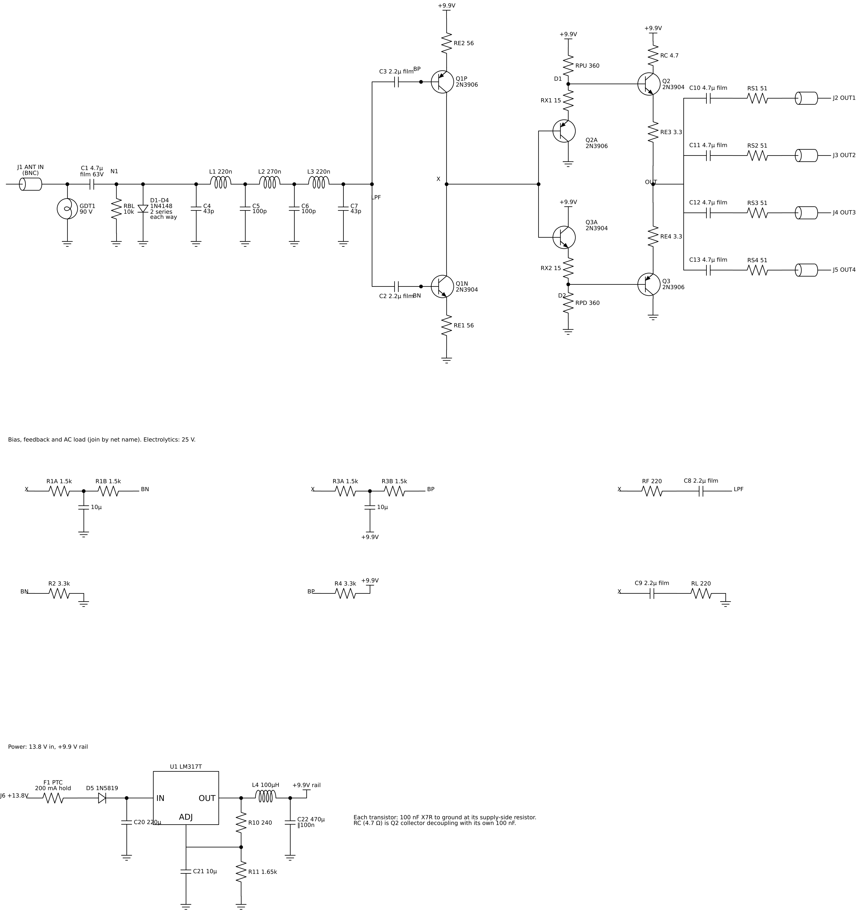
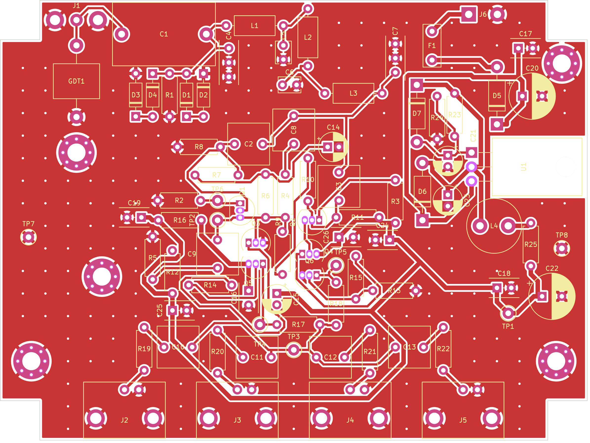

# HF Receive Multicoupler — Rev B

One antenna (an active receive loop such as the LZ1AQ AAA-1C or W6LVP) feeding four receivers: an RX888 or RSPdx plus vintage communications receivers. Four ports, through-hole, no hand-wound transformers, 13.8 V supply.

**Status:** design, simulation and a first prototype PCB layout (build A, branch `prototype-pcb`). Nothing here has been built or measured yet. All performance numbers are ngspice simulations with approximate transistor models. Treat them as estimates until the hardware is measured. The second verification pass ([`docs/review2-response.md`](docs/review2-response.md)) lists what is supported, what is not, and what needs bench work.



## Simulated performance, build A (recommended)

Conditions: 50 Ω source, four 50 Ω loads, measured at J2. Nominal parts, 9.81 V rail.

| Parameter | 1 MHz | 7–10 MHz | 28–30 MHz | 50 MHz |
| --- | --- | --- | --- | --- |
| Gain (dB) | +1.72 | +1.69 | +1.42 | +0.84 |
| Port-to-port isolation (dB) | 34.2 | 34.0 | 32.3 | 29.4 |
| Output-to-input isolation (dB) | 107 | 80 | 61 | 52 |
| NF (dB, excludes the receiver's own load noise) | 8.2 | 8.3 | 9.2 | 10.6 |
| IIP3 (dBm, −10 dBm tones) | +32.0 | +30.9 (7 MHz) | +27.1 (28 MHz) | — |

**Other figures:**

- **Flatness:** 0.88 dB from 10 kHz to 50 MHz (gain 1.72 dB at 10 kHz down to 0.84 dB at 50 MHz); 0.3 dB to 30 MHz.
- **Match:** S11 ≤ −23.3 dB and S22 ≤ −23.3 dB from 10 kHz to 50 MHz.
- **FM rejection:** 34.8 dB at 88 MHz, 44.8 dB at 100 MHz, 50.7 dB at 108 MHz.
- **IIP2:** about +79 dBm (6 + 7 MHz) and +79 to +82 dBm (0.6 + 1.0 MHz).
- **Output P1dB:** +11.7 dBm at 7 MHz.
- **Supply:** 95 mA from 13.8 V.

**Tolerance spread** (200-run Monte Carlo, every part independent, published tolerances, LPF inductors VNA-selected to ±3 %):

- gain at 1 MHz: 1.54–1.89 dB
- gain at 50 MHz: 0.69–1.04 dB
- flatness, 10 kHz–50 MHz: 0.79–0.91 dB
- worst S11: −19.4 dB (about −19.2 dB with the stocked ±5 % 43 pF end capacitors now in the BOM)
- rejection at 88 MHz: 33.4–35.8 dB
- NF at 10 MHz: 8.1–9.1 dB
- IIP3 at 7 MHz: +29.1 to +31.8 dBm
- IIP2: +60 to +88 dBm (depends on NPN/PNP matching)
- rail current: 79–97 mA

**If you skip inductor selection,** expect S11 as poor as about −11 dB, flatness up to ~1.3 dB and 88 MHz rejection down to ~31 dB.

All band-edge and named-frequency values come from exact single-frequency solves, not from the nearest sweep point (see section 0 of the review 2 response).

Builds B (+3.2 dB) and C (+5.5 dB) are in [`sim/results/summary.json`](sim/results/summary.json). Build C loses intercept quickly with signals near 0 dBm.

## Prototype PCB (build A)



- **Board:** 2 layers, through-hole, 104 × 78 mm, for a Hammond 1590C.
- **Connectors:** four R/A PCB BNC outputs on the front wall; input BNC on the left wall and DC jack on the back wall, both panel-mounted.
- **Checks:** DRC is clean, and the schematic, PCB and simulation netlists agree pin for pin. KiCad's own ERC still needs one run in eeschema (KiCad 7 has no command-line ERC).
- **Layout-parasitic estimate (simulated):** with the estimated trace capacitance, worst S11 moves from −23 dB to about −18 dB. The gain response barely moves.
- **Before ordering:** the enclosure dimensions and connector panel cut-outs still need checking on real parts.

Details: [`docs/pcb-prototype-A.md`](docs/pcb-prototype-A.md).

## Repository layout

| Path | Contents |
| --- | --- |
| `hardware/` | Schematic (`schematic_revB.png/.svg`, generated by `sch_revb.py`); sourced BOM (`BOM_revB.csv`) |
| `docs/review2-response.md` | Current verification status (supersedes parts of `review-response.md`) |
| `docs/bringup-and-test.md` | Inductor selection, power-only test with dummy load, bring-up and bench tests |
| `docs/layout-guidance.md` | PCB layout rules |
| `docs/pcb-prototype-A.md` | Prototype PCB (build A): part and footprint choices, layout, checks done, Hammond 1590C fit and drilling, layout-parasitic estimate, open items before ordering |
| `hardware/kicad/` | KiCad 7 project (schematic, PCB, footprint library), Gerbers and drill, BOM with MPNs and footprints, board and enclosure images, generator and check scripts |
| `sim/scripts/gen.py` | Single netlist generator; builds A/B/C in `BUILDS`; checked simulation runner |
| `sim/spice/*.cir` | Standalone decks for build A (exported by `export_netlists.py`) |
| `sim/results/` | All generated results |

## Running the simulations

Requires ngspice 42 or later and Python 3 with numpy and matplotlib. Run from `sim/scripts`:

```
python3 test_harness.py       # 26 regression checks: failure handling + exact-frequency sampling
python3 run_all.py            # builds A, B, C: op, AC, NF, IP3/IP2 (80 and 160 steps), P1dB -> summary.json
python3 convergence.py        # two-tone timestep / reltol / method study
python3 mc.py 200 200         # Monte Carlo + corners -> mc_A.json
python3 lpf_study.py 100      # LPF tolerance options
python3 stability.py A        # 5-port S-matrix mu test + 33 cable-kick cases (also B, C); then mu_bands.py A
python3 supply.py             # start-up, headroom, rail impedance, ripple bound, fault, dummy load
python3 freq_density.py       # passband extrema vs sweep density (25-400 points/decade)
python3 thermal.py; python3 export_netlists.py; python3 plot.py
```

Every run uses its own temporary directory and is rejected on any of these:

- non-zero exit
- simulator error text
- missing completion marker
- a missing, stale, empty, non-finite or truncated output

Failures are counted and reported, never skipped.

**Name map** (generator → schematic): CIN1 = C1, CBN/CBP = C2/C3, CF1–CF4 = C4–C7, LF1–LF3 = L1–L3, CFB = C8, CLX = C9, RLX = RL, REO1/REO2 = RE3/RE4, RCOL = RC, CO1–CO4 = C10–C13, CRM/CRMP = C14/C15, CU1O = C23.

## Model limits

- **Transistor models:** 2N3904/2N3906 are simplified Gummel-Poon models from the LTspice library. Absolute IP3/IP2 can differ from hardware by several dB, and IP2 depends on device matching.
- **50 MHz gain:** depends on the real collector capacitance. With CJC 40 % higher than modelled, gain at 50 MHz drops to +0.33 dB (1.39 dB flatness).
- **Regulator model:** the LM317 is behavioural, with ideal line rejection and typical dropout.
- **Stability:** checked to 2 GHz with lumped parasitics. The models are unreliable above ~500 MHz, so a hardware oscillation check is required.
